# El destino de los aventureros: El juicio de los Celestiales (versión manual)

> 🌐 [English](README.md) · **Español**

▶ **Versión en línea:** https://nailuj1992.github.io/fate-of-the-adventurers-manual/ (se publica automáticamente en GitHub Pages cada vez que se fusiona un pull request hacia `master`)

Sorteo **configurable** (de 1 a 50 premios) sin servidor ni instalación: abre `index.html` en el navegador
(mantén `core.js` y la carpeta `img/` a su lado). Aquí **el presentador confirma la presencia a mano** tras comprobar el chat;
no hay conexión con Twitch (para eso está el repositorio hermano `fate-of-the-adventurers-twitch`). El motor es el mismo (`core.js`), así que las reglas son idénticas.

## Paso a paso (con pantallazos)

Los pantallazos usan nombres de participantes ficticios y tiempos cortos (4–14 s) para que todo el evento quepa en pocos minutos; los valores por defecto están en *Configurar un sorteo*.

**1. Abre la página.** Abre `index.html` (o la versión en línea). La pestaña **Participantes** es el punto de partida; **EN | ES** cambia el idioma.

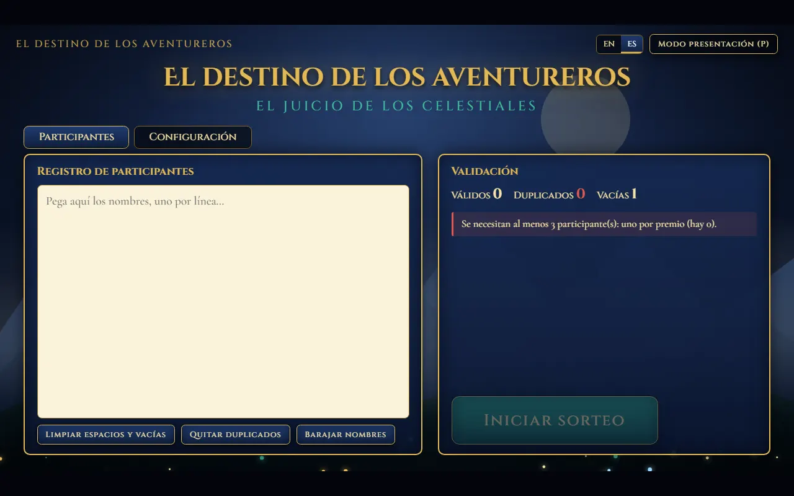

**2. Pega los participantes**, uno por línea. El panel cuenta las líneas válidas, duplicadas y vacías (*Quitar duplicados* y *Limpiar espacios* las arreglan) y avisa cuando todo está listo. El botón **Barajar nombres** reordena la lista al azar (al iniciar, el sorteo la vuelve a barajar).

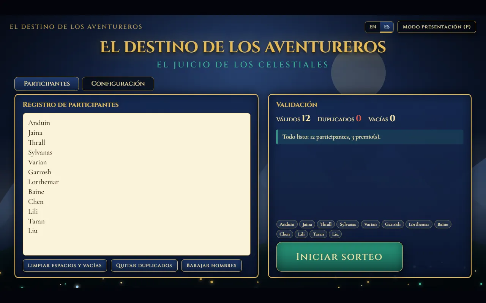

**3. Configura premios y tiempos** en la pestaña **Configuración**: cantidad de ganadores, tiempo para confirmar presencia y duración de cada fase; a la derecha se ve el orden de los Celestiales.

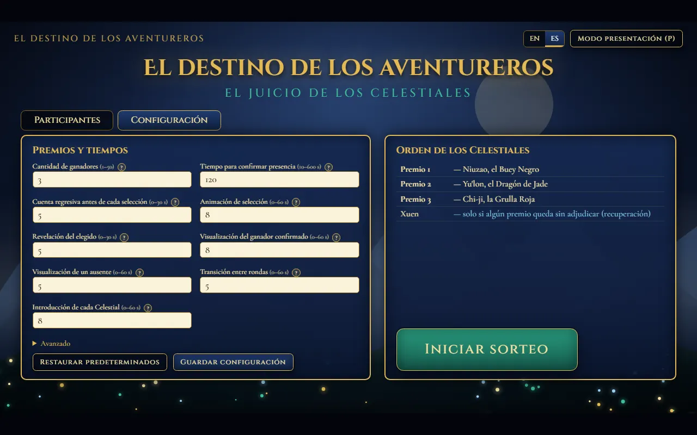

La sección **Avanzado** (margen de entrega extra y tiempo de recuperación) y los iconos **«?»** explican cada opción. Guarda la configuración o ve directo a **Iniciar sorteo**.

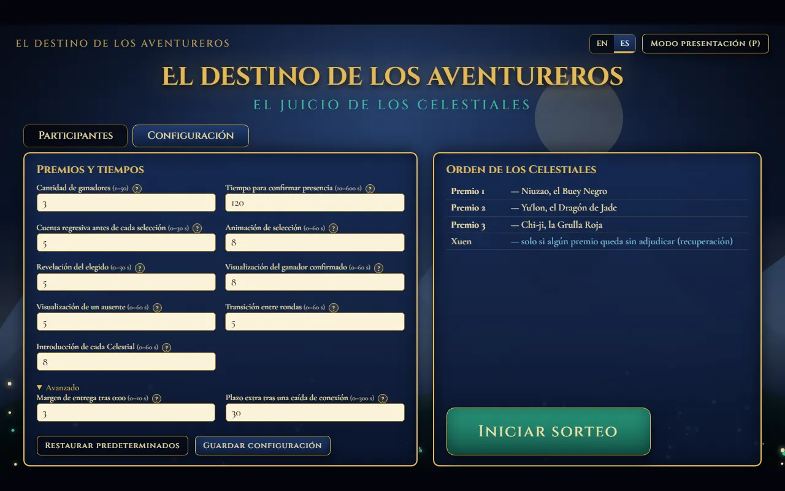

**4. Inicia el sorteo.** Te pide confirmar el número de participantes y de premios. Una vez iniciado, la configuración queda bloqueada.

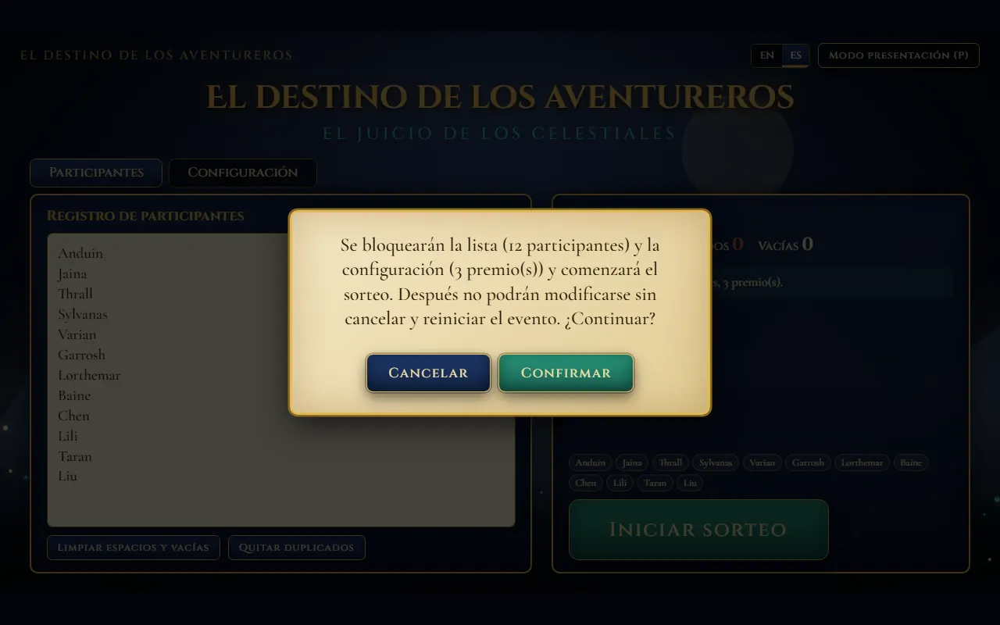

**5. Cada ronda avanza sola.** Se presenta al Celestial, luego vienen la cuenta atrás, la animación de selección y la revelación de la persona elegida. El sorteo usa `crypto.getRandomValues`.

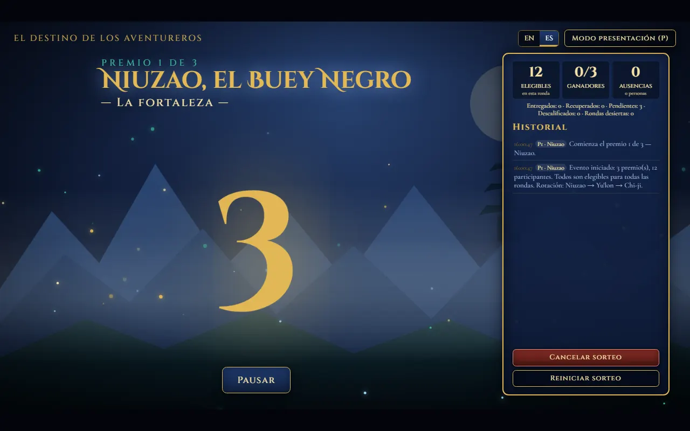

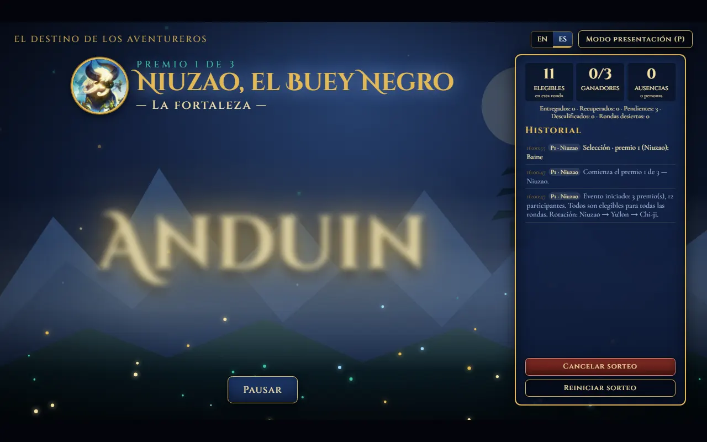

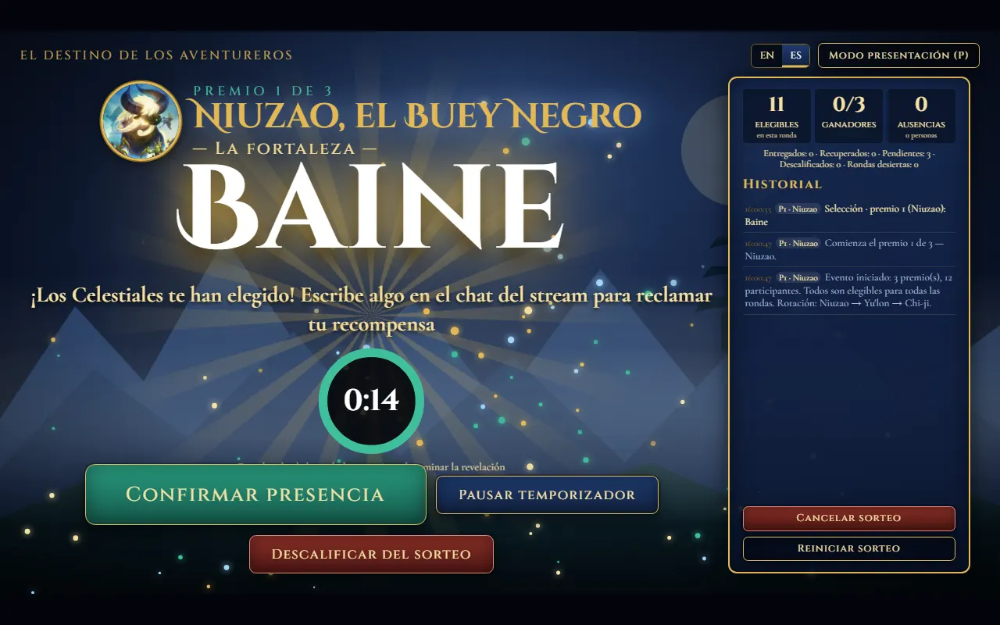

**6. Espera la confirmación.** La persona elegida tiene el tiempo de confirmación para escribir en el chat del stream; cuando lo veas, pulsa **Confirmar presencia**. Puedes **pausar** el temporizador o **descalificar** a la persona (con confirmación y motivo escrito).

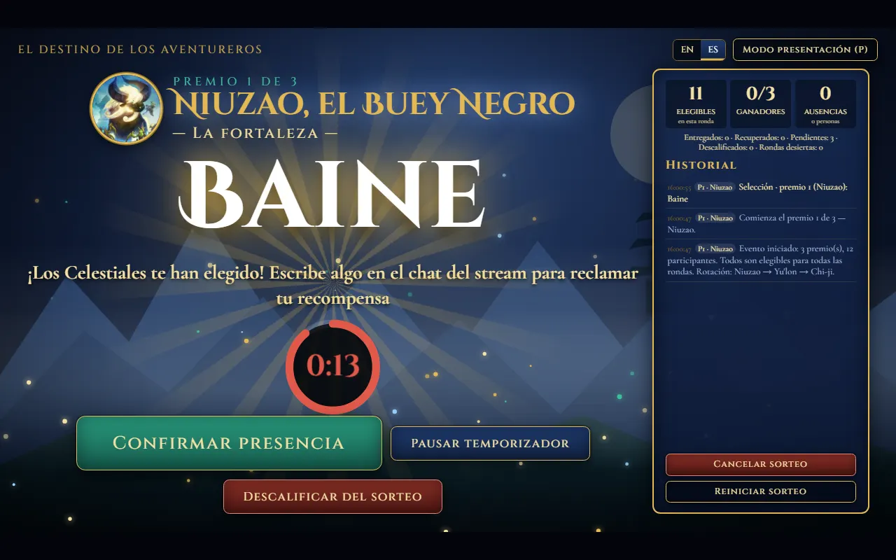

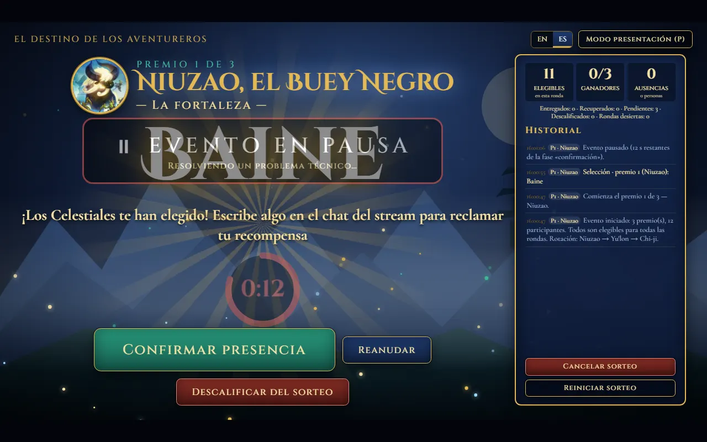

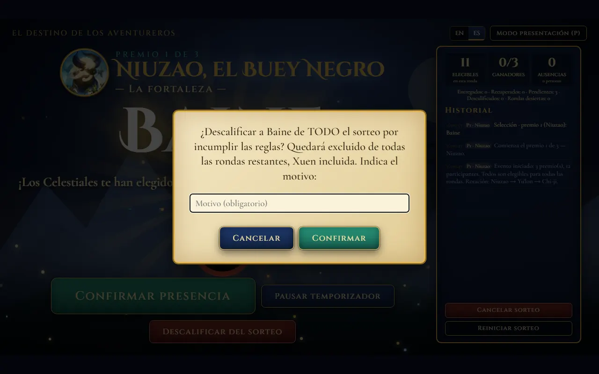

**7. Ganador y transición.** Se muestra al ganador confirmado y empieza la siguiente ronda con el siguiente Celestial.

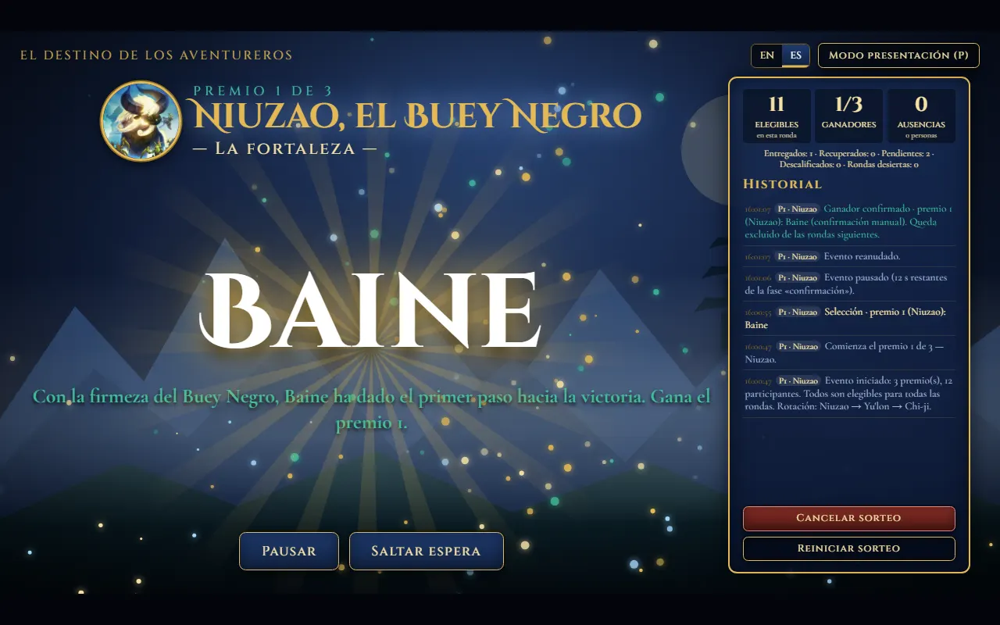

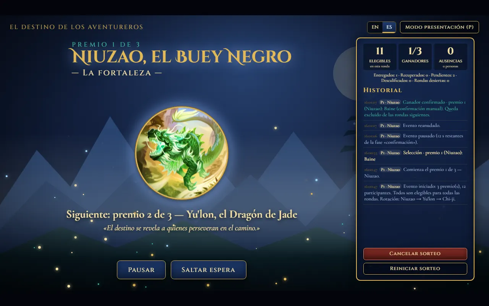

**8. Ausencia.** Si se agota el tiempo, la persona se muestra como ausente (excluida solo de esa ronda) y se sortea otro candidato. Si solo queda una persona elegible, se revela directamente, sin cuenta atrás ni roll.

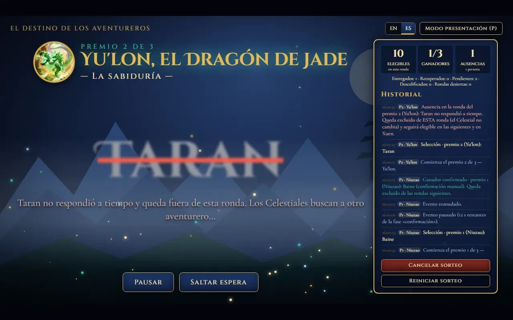

**9. Pantalla final e historial.** Cuando todos los premios están asignados (o recuperados por Xuen), se muestran los ganadores con su Celestial; el presentador entrega los códigos en persona. El historial conserva cada paso del evento.

## Configurar un sorteo
En el panel de administración, pestaña **Configuración**:
1. **Cantidad de ganadores**: 1–50 (por defecto 3), sin superar los participantes válidos.
2. **Tiempos** (segundos, enteros): confirmar presencia 120 (10–600) · cuenta atrás 5 · animación de selección 8 · revelación 5 · ganador visible 8 · ausente visible 5 · transición entre rondas 5 · introducción de cada Celestial 8. Avanzado: margen de entrega 3 (0 = estricto) y plazo extra 30.
3. La **vista previa** muestra el orden de los Celestiales (con 8 premios: Niuzao, Yu'lon, Chi-ji, Niuzao, Yu'lon, Chi-ji, Niuzao, Yu'lon).
4. **Restaurar predeterminados**, **Guardar configuración** e **Iniciar sorteo** (usa y guarda lo que ves).

**Ejemplo: 5 premios y 90 s para confirmar** → pega al menos 5 nombres en *Participantes*, pon `5` y `90` en *Configuración*, revisa la vista previa e inicia.

La configuración se guarda en el **navegador** (`localStorage`, sin credenciales) y persiste entre sesiones; queda **bloqueada al iniciar** el evento (para cambiarla hay que cancelar o reiniciar con confirmación). Valores y límites por defecto: `core.js → DEFAULT_CONFIG / LIMITS`.

## Flujo (automático tras «Iniciar sorteo»)
Introducción del Celestial → cuenta atrás → selección → revelación → espera de confirmación → ganador o ausente visible → transición → siguiente ronda.
- **Barajado:** al iniciar el sorteo, la lista de participantes se baraja en un orden aleatorio seguro (Fisher–Yates con `crypto.getRandomValues`), así que el orden en que se escribieron los nombres no influye; queda anotado en el historial.
- **Último candidato:** siempre que quede **una sola** persona elegible para un sorteo (porque los demás no respondieron o ya ganaron, Xuen incluido), ya no hay nada que sortear: se salta la cuenta atrás y el roll y esa persona se revela de inmediato como candidata (aun así debe confirmar su presencia a tiempo).
- El **plazo de confirmación empieza al terminar la revelación**; ninguna animación previa descuenta tiempo.
- Controles: **Confirmar presencia** (cuando compruebas que escribió en el chat), **Pausar** (congela la fase en curso, también el plazo), **Saltar espera**, **Descalificar del sorteo** (global, con confirmación y motivo obligatorio), **Cancelar sorteo** y **Reiniciar sorteo**.
- Si **actualizas la página (F5)** durante un evento, se **restaura** (estado en `localStorage`, con el plazo calculado desde su hora límite absoluta). Al terminar o volver al panel, ese estado se borra.
- Modo presentación para OBS: tecla `P` (salir con `Esc`) o `index.html?view=presentation`.

## Idiomas (i18n)
Interfaz en **inglés (por defecto)** y **español**; el inglés es el idioma por defecto sin importar el del navegador. Selector **EN | ES** arriba a la derecha (se recuerda en `localStorage`) o `index.html?lang=es`. Cambia todo al instante, historial incluido. Los textos están en `locales/en.js` y `locales/es.js`; mantén `core.js`, `i18n.js` y `locales/` junto a `index.html`.

## Reglas
- **Rotación circular** Niuzao → Yu'lon → Chi-ji según el **índice de la ronda** (no según los ganadores). Una ausencia **no cambia el Celestial**; la rotación solo avanza al confirmarse un ganador o quedar la ronda desierta.
- **Ausencia**: excluido solo de *esa ronda* (puede salir en una ronda posterior aunque tenga el mismo Celestial, y en Xuen).
- **Ganador confirmado**: excluido de todo lo posterior (un premio por persona).
- **Descalificación global**: excluido de todas las rondas restantes, Xuen incluida.
- **Ronda sin elegibles**: desierta; su premio pasa a recuperación y el evento continúa.
- **Xuen — La fuerza**: Celestial exclusivo de la recuperación; solo aparece si quedan premios sin adjudicar (todos los intentos bajo Xuen, en orden). Los ausentes de las rondas principales participan; un ausente en Xuen queda fuera de toda la recuperación. Si se agotan los candidatos, los premios restantes quedan sin adjudicar.
- La pantalla muestra premios entregados / recuperados / pendientes, y distingue **eventos de ausencia** de **personas únicas ausentes**. El historial lleva premio, Celestial y ronda principal o recuperación.

## Limitaciones
- Todo vive en la página: si **cierras la pestaña** el evento queda guardado en `localStorage` y se restaura al volver a abrirla, pero borrar los datos del navegador lo elimina. Los datos de `localStorage` pueden no estar disponibles en ventanas privadas (la app funciona igual, sin persistencia).
- Con los tiempos por defecto cada premio ronda 30–35 s de animaciones y esperas más el plazo; ajusta los tiempos o usa *Saltar espera*.
- No se muestran ni guardan los códigos de los premios.

## Personalizar
Comentarios `PERSONALIZACIÓN` en `index.html`: colores y fondo (variables CSS), colores de brillo de los Celestiales (`STORY`), sonidos (`SOUNDS`) e imágenes (`EMBLEMS`, carpeta `img/`). Tiempos y límites: `core.js`. Textos de la interfaz y de los Celestiales: `locales/*.js`.
La selección usa `crypto.getRandomValues` con rechazo (sin sesgo de módulo); no se usa `Math.random`.
