# The Fate of the Adventurers: The Trial of the Celestials (manual version · v3)

> 🌐 **English** · [Español](README.es.md)

▶ **Live version:** https://nailuj1992.github.io/fate-of-the-adventurers-manual/ (published automatically on GitHub Pages whenever a pull request is merged into `master`)

A **configurable** draw (1 to 50 prizes) with no server and no installation: open `index.html` in your browser
(keep `core.js`, `i18n.js` and the `locales/` and `img/` folders next to it). Here **the presenter confirms presence by hand** after checking the chat;
there is no Twitch connection (that is what the sibling repository `fate-of-the-adventurers-twitch` is for). The engine is the same (`core.js`), so the rules are identical.

## Step by step (with screenshots)

The screenshots use fictional participant names and short timings (4–14 s) so the whole event fits in a few minutes; the defaults are in *Set up a draw*.

**1. Open the page.** Open `index.html` (or the live version). The **Participants** tab is where everything starts; **EN | ES** switches the language.

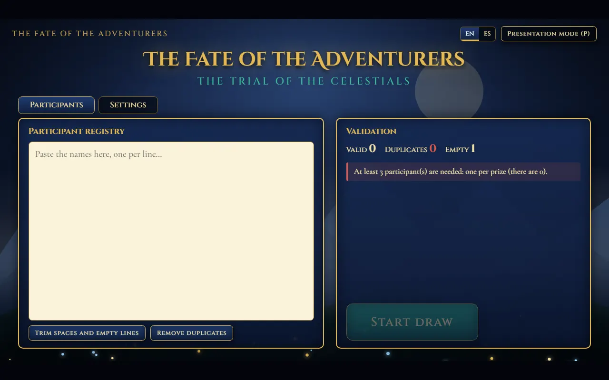

**2. Paste the participants**, one per line. The panel counts valid, duplicate and empty lines (*Remove duplicates* and *Trim spaces* clean them up) and tells you when everything is ready.

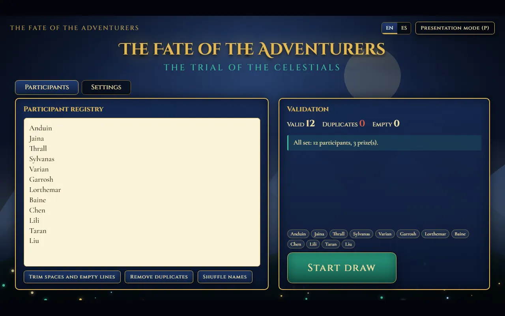

**3. Set the prizes and timings** in the **Settings** tab: number of winners, time to confirm presence and the duration of each phase, with the order of the Celestials on the right.

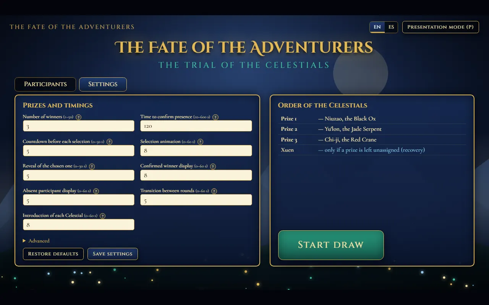

The **Advanced** section (extra delivery margin and recovery time) and the **"?"** help icons explain every option. Save the settings or go straight to **Start draw**.

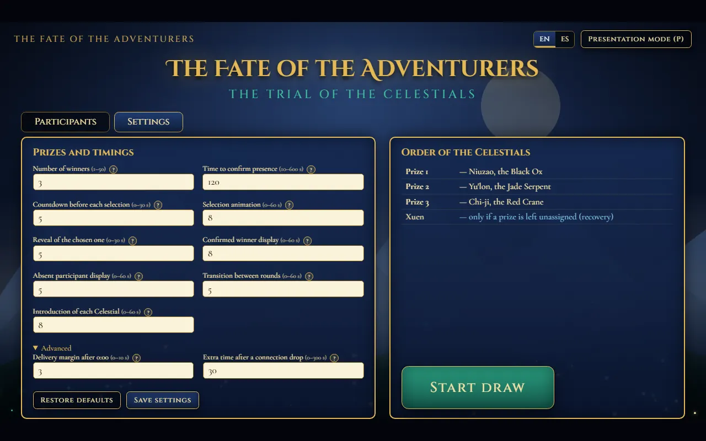

**4. Start the draw.** You are asked to confirm the number of participants and prizes. Once started, the settings are locked.

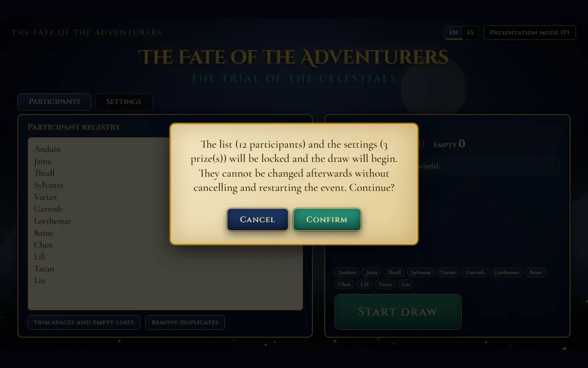

**5. Each round runs by itself.** The Celestial is introduced, then the countdown, the selection animation and the reveal of the chosen person. The draw uses `crypto.getRandomValues`.

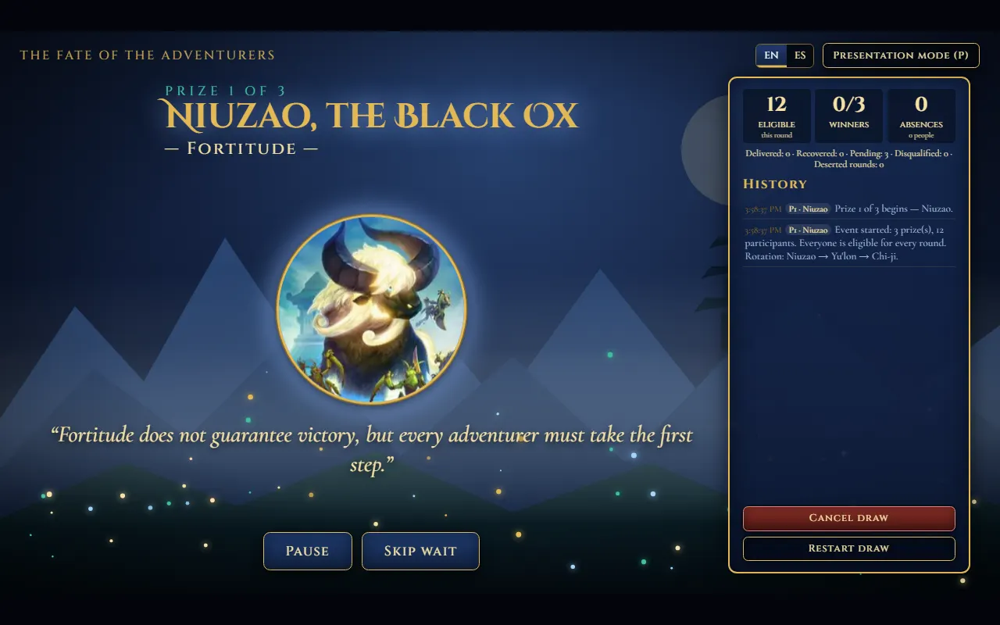

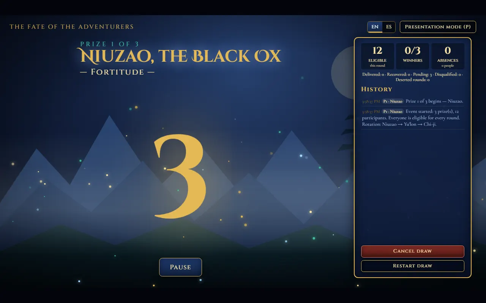

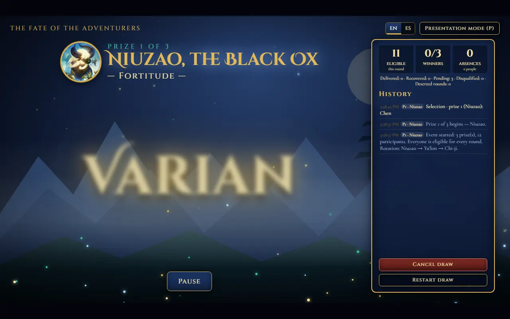

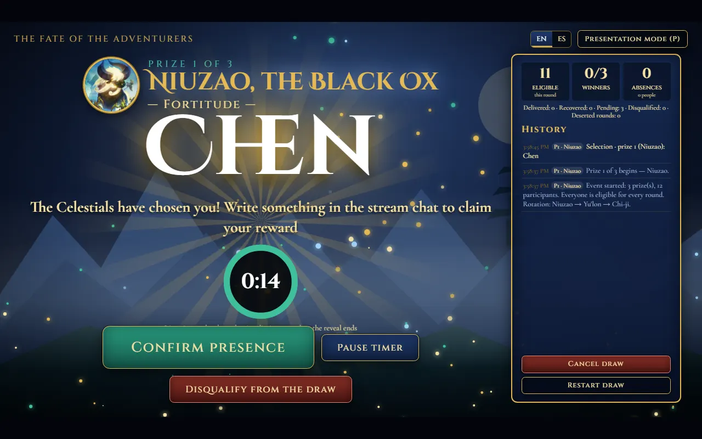

**6. Wait for the confirmation.** The chosen person has the confirmation time to write in the stream chat; when you see it, press **Confirm presence**. You can **pause** the timer or **disqualify** the person (with a confirmation and a written reason).

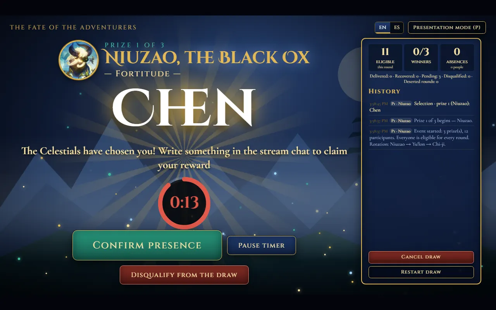

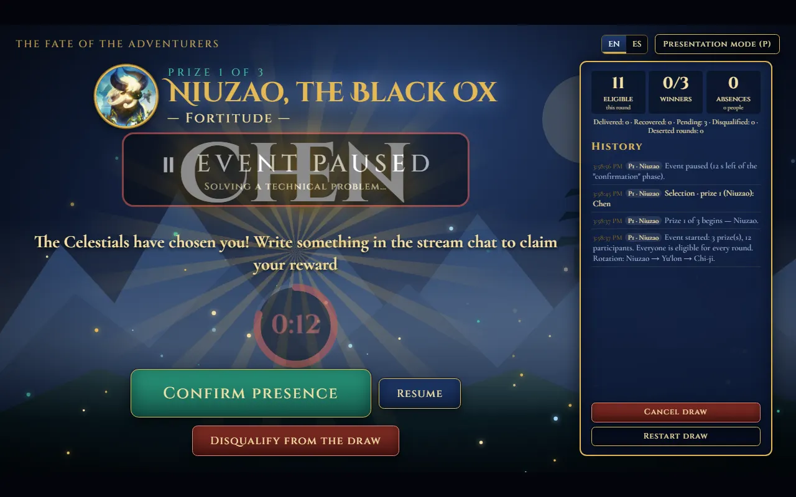

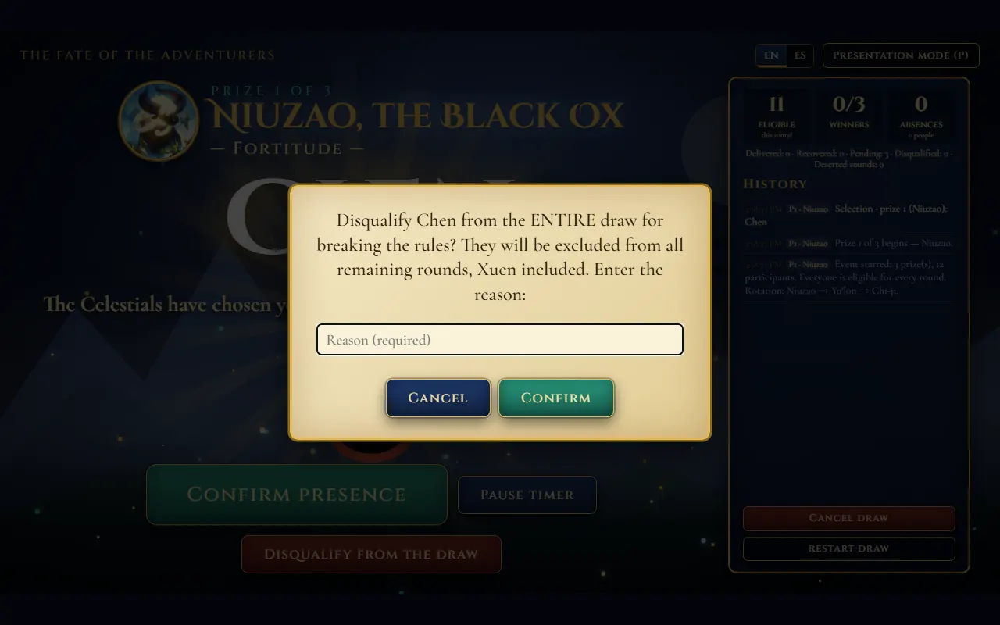

**7. Winner and transition.** A confirmed winner is shown, then the next round starts with the next Celestial.

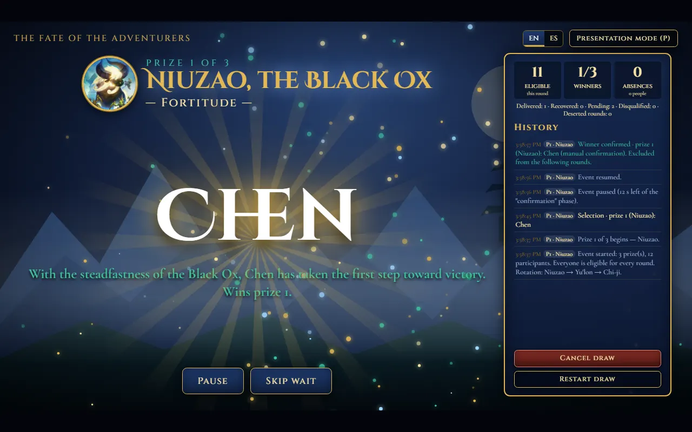

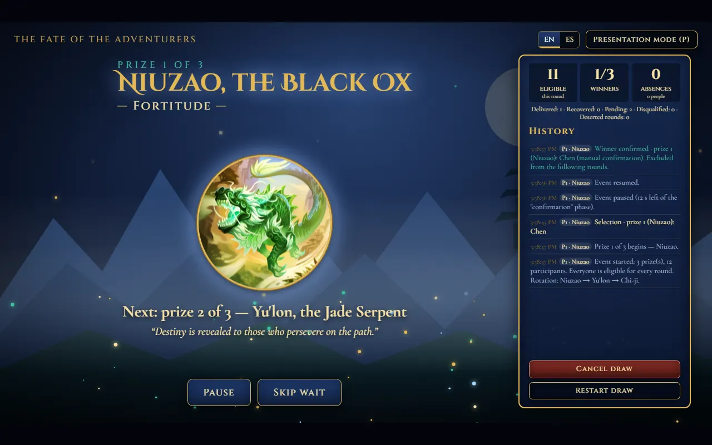

**8. Absence.** If the time runs out, the person is shown as absent (excluded from that round only) and another candidate is drawn. If only one eligible person is left, they are revealed directly, without countdown or roll.

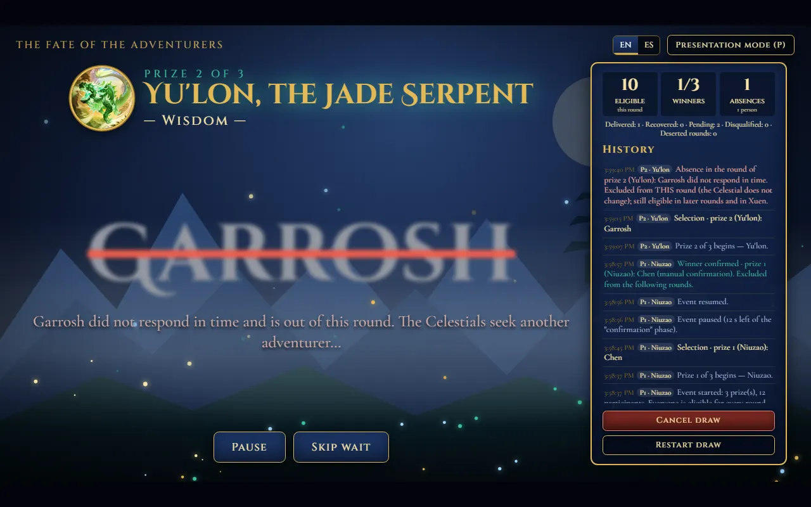

**9. Final screen and history.** When all the prizes are assigned (or recovered by Xuen), the winners are shown with their Celestial; the presenter hands the codes over personally. The history keeps every step of the event.

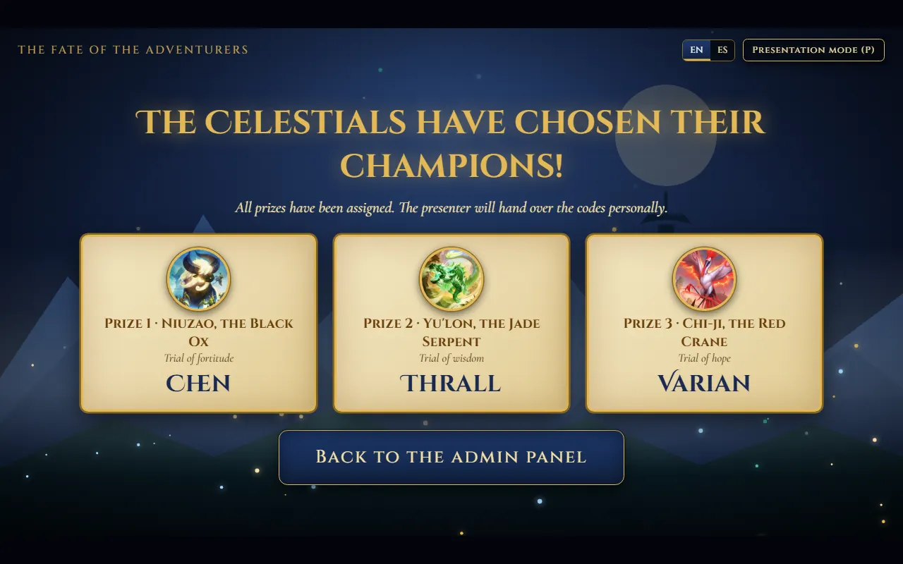

## Set up a draw
In the admin panel, **Settings** tab:
1. **Number of winners**: 1–50 (default 3), not exceeding the number of valid participants.
2. **Timings** (whole seconds): confirm presence 120 (10–600) · countdown 5 · selection animation 8 · reveal 5 · winner display 8 · absent display 5 · transition between rounds 5 · introduction of each Celestial 8. Advanced: delivery margin 3 (0 = strict) and extra time 30.
3. The **preview** shows the order of the Celestials (with 8 prizes: Niuzao, Yu'lon, Chi-ji, Niuzao, Yu'lon, Chi-ji, Niuzao, Yu'lon).
4. **Restore defaults**, **Save settings** and **Start draw** (it uses and saves what you see).
5. Each option has a **"?" icon** with an explanation (hover it or focus it with the keyboard).

**Example: 5 prizes and 90 s to confirm** → paste at least 5 names in *Participants*, enter `5` and `90` in *Settings*, check the preview and start.

The settings are stored in the **browser** (`localStorage`, no credentials) and persist between sessions; they are **locked once the event starts** (to change them you must cancel or restart with confirmation). Default values and limits: `core.js → DEFAULT_CONFIG / LIMITS`.

## Flow (automatic after "Start draw")
Celestial introduction → countdown → selection → reveal → wait for confirmation → winner or absent shown → transition → next round.
- **Last candidate:** if, after the others did not answer, only **one** eligible person is left for that prize, there is nothing left to draw: the countdown and the roll are skipped and that person is revealed right away as the candidate (they still have to confirm their presence in time).
- The **confirmation time starts when the reveal ends**; no earlier animation uses up any time.
- Controls: **Confirm presence** (when you have checked that they wrote in the chat), **Pause** (freezes the current phase, including the time limit), **Skip wait**, **Disqualify from the draw** (global, with confirmation and a required reason), **Cancel draw** and **Restart draw**.
- If you **refresh the page (F5)** during an event, it is **restored** (state in `localStorage`, with the time limit computed from its absolute deadline). When it finishes or you return to the panel, that state is deleted.
- Presentation mode for OBS: `P` key (exit with `Esc`) or `index.html?view=presentation`.

## Languages (i18n)
Interface in **English (default)** and **Spanish**; English is the default regardless of the browser's language. **EN | ES** switch at the top right (remembered in `localStorage`) or `index.html?lang=es`. It changes everything instantly, history included. The texts are in `locales/en.js` and `locales/es.js`; keep `core.js`, `i18n.js` and `locales/` next to `index.html`.

## Rules
- **Circular rotation** Niuzao → Yu'lon → Chi-ji according to the **round index** (not the winners). An absence **does not change the Celestial**; the rotation only advances when a winner is confirmed or the round ends deserted.
- **Absence**: excluded from *that round* only (they can come up in a later round even if it has the same Celestial, and in Xuen).
- **Confirmed winner**: excluded from everything afterwards (one prize per person).
- **Global disqualification**: excluded from all remaining rounds, Xuen included.
- **Round with no eligible participants**: deserted; its prize moves to recovery and the event continues.
- **Xuen — Strength**: the Celestial exclusive to recovery; it only appears if prizes are left unassigned (all attempts under Xuen, in order). People absent in the main rounds take part; someone absent in Xuen is out of the whole recovery. If the candidates run out, the remaining prizes stay unassigned.
- The screen shows prizes delivered / recovered / pending, and tells **absence events** apart from **unique absent people**. The history carries the prize, the Celestial and main or recovery round.

## Limitations
- Everything lives in the page: if you **close the tab** the event stays saved in `localStorage` and is restored when you reopen it, but clearing the browser data deletes it. `localStorage` may be unavailable in private windows (the app still works, without persistence).
- With the default timings each prize takes about 30–35 s of animations and waits plus the time limit; adjust the timings or use *Skip wait*.
- Prize codes are neither shown nor stored.

## Customize
`PERSONALIZACIÓN` comments in `index.html`: colors and background (CSS variables), the Celestials' glow colors (`STORY`), sounds (`SOUNDS`) and images (`EMBLEMS`, `img/` folder). Timings and limits: `core.js`. Interface and Celestial texts: `locales/*.js`.
The draw uses `crypto.getRandomValues` with rejection (no modulo bias); `Math.random` is never used.
